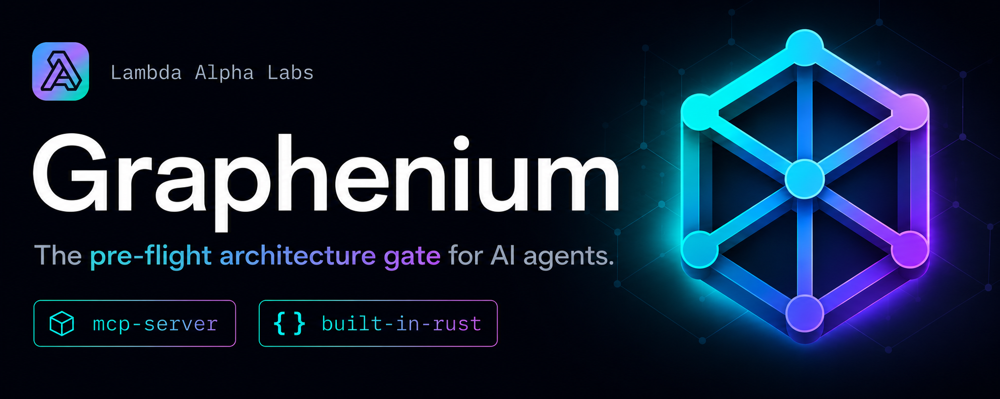

  

<h3 align="center">Relational Codebase Compilation & Spec-Driven Containment for Autonomous Engineering</h3>

**Lambda Alpha Labs** builds compiler-grade structural verification and external governance infrastructure for AI-assisted software engineering.

Our flagship system is **[Graphenium (`gm`)](https://github.com/lambda-alpha-labs/Graphenium)** — the local relational codebase compiler and spec-driven containment engine for AI coding agents (Claude Code, Cursor, Codex, Grok, OpenCode).

Compilers verify syntax. Type checkers verify local types. Test runners verify runtime outputs. **Graphenium is Layer 4 of the verification stack**: it compiles polyglot repositories (Rust, Python, Go, TypeScript, JavaScript, Java, C, C++, C#, and Lean 4) into a provenance-tagged relational index (`EXTRACTED`, `INFERRED`, `AMBIGUOUS`), giving agents sub-50ms structural intelligence while mechanically blocking layering bypasses, Louvain modularity decay ($\Delta Q$), proof-gap taint, and post-edit scope creep.

---

## Core Technical Capabilities

* **Deterministic Polyglot Compilation:** Tree-sitter + import-scoped Stack Graphs across 10 languages (including recursive C# `.sln`/`.csproj` assembly boundaries and native Lean 4 `sorry`/`admit` proof-gap extraction), cutting agent context token burn by ~85%.
* **Intent–Implementation Decoupling (Virtual ASTs):** Agents declare proposed symbols and dependency edges in an in-memory planning workspace (`create_planning_workspace`), receiving exact topological counterexamples in milliseconds before touching disk.
* **Embedded Semi-Naive Datalog Engine:** Evaluates multi-hop transitive layer bypasses (`bypasses_layer`), cycles (`circular_dependency`), call-site container aliasing hazards (`aliased_container_call`), dead code (`unreachable_from`), and formal proof-gap taint (`tainted_by_proof_gap`).
* **Zero-Config Topological Entropy Guardrails (Louvain $\Delta Q$):** Partitions physical baseline and virtual plan subgraphs in memory to reject plans that decay modularity ($\Delta Q$) or introduce high-surprise shortcuts (`cross-community`, `peripheral→hub`)—with zero configuration files required.
* **Closed-Loop Post-Edit Audits:** Verifies realized symbols, realized dependency edges, and git/snapshot-diff file scope to mechanically block scope creep in MCP and CI.

---

## The Graphenium Ecosystem

* **[Graphenium Core](https://github.com/lambda-alpha-labs/Graphenium)** *(Open Source · MIT)* — Local-first relational codebase compiler, embedded Datalog & Louvain $\Delta Q$ solver, and 24-tool MCP server (`gm`). Runs 100% offline with zero API keys required.
* **[Graphenium Gate](https://graphenium.dev/#gate)** *(Commercial CI/CD Layer)* — Automated pull-request and CI containment gating: pre-flight policy proofs, per-PR modularity delta ($\Delta Q$) audits, scope-creep blocking, and risk-sorted verification plans.
* **[Graphenium Enterprise](https://graphenium.dev)** *(Control Plane)* — Organization-wide architectural governance, cross-repository blast-radius registries, centralized policy consoles, SSO/RBAC, and self-hosted deployment.

---

## Start Here

| Resource | Link | Description |
| :--- | :--- | :--- |
| 🖥️ **Core Repository** | [**`lambda-alpha-labs/Graphenium`**](https://github.com/lambda-alpha-labs/Graphenium) | Open-source Rust CLI (`gm`), Datalog/Louvain engine, and MCP server |
| 📖 **Documentation** | [**Architecture & Docs**](https://github.com/lambda-alpha-labs/Graphenium/tree/main/docs) | System architecture, epistemic trust model, MCP tools, and CI governance |
| 🌐 **Website** | [**graphenium.dev**](https://graphenium.dev) | Product overview, Graphenium Gate early access, and enterprise inquiries |
| ✉️ **Contact** | [**hello@graphenium.dev**](mailto:hello@graphenium.dev) | Design partners, enterprise pilots, and engineering inquiries |
